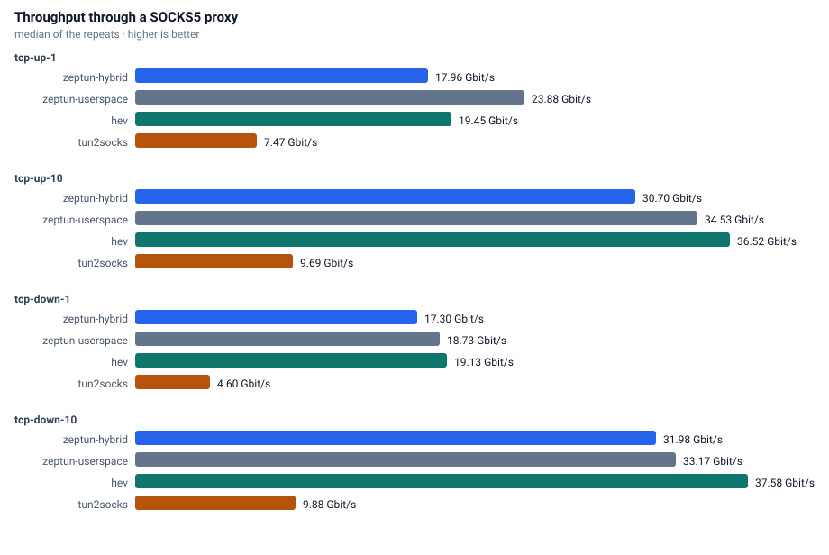
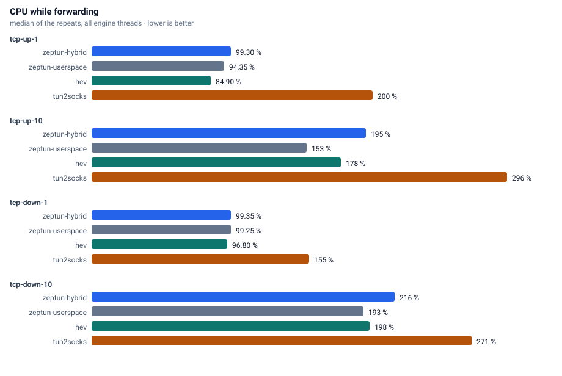
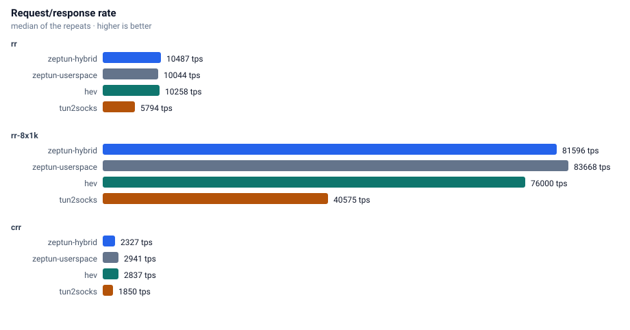
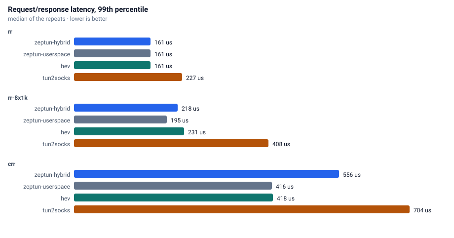
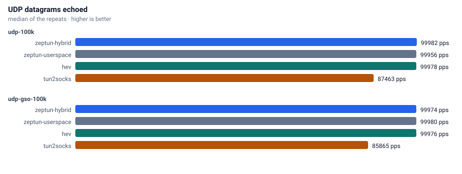
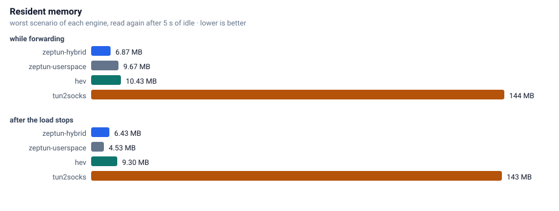

# Benchmarks

Every number on this page comes from the `benchmark` workflow in this repository, run on a GitHub-hosted runner.

## Machine

| property | value |
|---|---|
| runner image | ubuntu24 20261111.370.1 |
| cpu | Intel(R) Xeon(R) 6973P-C |
| cpu cores | 4 |
| memory | 15.6 GB |
| kernel | Linux 7.0.0-1017-azure |
| zig | 0.17.1 |
| date | 2026-11-15 |

## Method

Two network namespaces joined by a veth pair. Traffic enters the tunnel device (MTU 8500), leaves through the same SOCKS5 server (hev-socks5-server) for every engine, and reaches the servers in the second namespace. Engines are interleaved: each round starts every engine once and runs every scenario against it, so background noise spreads evenly. CPU comes from `/proc/<pid>/stat` and memory from `VmRSS`, summed over all processes of an engine.

Duration 8 s per scenario, 2 rounds, 4 queues. Memory is read twice: the highest sample while the scenario runs, and again after 5 s of idle, which shows whether an engine gives the memory back.

## Throughput

## CPU

## Request/response

## UDP

## Memory

## Raw results

| engine | scenario | median | cpu % | max rss MB | rss after idle MB |
|---|---|---:|---:|---:|---:|
| zeptun-userspace | tcp-up-1 | 23.966 Gbit/s | 94 | 3.0 | 1.7 |
| zeptun-userspace | tcp-up-10 | 34.577 Gbit/s | 153 | 9.9 | 2.7 |
| zeptun-userspace | tcp-down-1 | 19.207 Gbit/s | 99 | 2.9 | 2.7 |
| zeptun-userspace | tcp-down-10 | 33.298 Gbit/s | 193 | 6.4 | 2.8 |
| zeptun-userspace | rr | 10130 tps p50=96us p99=160us p99.9=332us  | 23 | 2.9 | 2.8 |
| zeptun-userspace | rr-8x1k | 84185 tps p50=89us p99=200us p99.9=280us  | 94 | 3.0 | 2.9 |
| zeptun-userspace | crr | 2992 tps p50=324us p99=408us p99.9=600us  | 35 | 4.8 | 4.5 |
| zeptun-userspace | udp-100k | 99956 echo pps (100.0% of 99984 sent)  | 30 | 5.1 | 4.6 |
| zeptun-userspace | udp-gso-100k | 99988 echo pps (100.0% of 99992 sent)  | 23 | 5.4 | 4.4 |
| hev | tcp-up-1 | 19.637 Gbit/s | 85 | 8.8 | 8.6 |
| hev | tcp-up-10 | 37.810 Gbit/s | 178 | 10.5 | 8.9 |
| hev | tcp-down-1 | 19.152 Gbit/s | 97 | 8.9 | 8.9 |
| hev | tcp-down-10 | 38.167 Gbit/s | 198 | 9.5 | 8.9 |
| hev | rr | 10302 tps p50=91us p99=160us p99.9=226us  | 26 | 8.9 | 8.9 |
| hev | rr-8x1k | 80732 tps p50=92us p99=218us p99.9=288us  | 117 | 9.0 | 8.9 |
| hev | crr | 2928 tps p50=336us p99=420us p99.9=712us  | 45 | 8.9 | 8.9 |
| hev | udp-100k | 99986 echo pps (100.0% of 99996 sent)  | 36 | 9.1 | 9.1 |
| hev | udp-gso-100k | 99988 echo pps (100.0% of 99992 sent)  | 37 | 9.4 | 9.3 |
| zeptun-hybrid | tcp-up-1 | 18.143 Gbit/s | 99 | 2.2 | 2.0 |
| zeptun-hybrid | tcp-up-10 | 31.789 Gbit/s | 195 | 3.8 | 2.8 |
| zeptun-hybrid | tcp-down-1 | 17.384 Gbit/s | 99 | 3.1 | 2.6 |
| zeptun-hybrid | tcp-down-10 | 33.453 Gbit/s | 216 | 3.8 | 2.9 |
| zeptun-hybrid | rr | 10498 tps p50=83us p99=162us p99.9=180us  | 27 | 2.9 | 2.7 |
| zeptun-hybrid | rr-8x1k | 89751 tps p50=83us p99=212us p99.9=300us  | 135 | 2.8 | 2.4 |
| zeptun-hybrid | crr | 2362 tps p50=408us p99=544us p99.9=880us errors=60  | 55 | 6.5 | 6.4 |
| zeptun-hybrid | udp-100k | 99984 echo pps (100.0% of 99996 sent)  | 35 | 6.8 | 6.4 |
| zeptun-hybrid | udp-gso-100k | 99976 echo pps (100.0% of 99992 sent)  | 22 | 7.0 | 6.5 |
| tun2socks | tcp-up-1 | 7.482 Gbit/s | 200 | 17.6 | 17.1 |
| tun2socks | tcp-up-10 | 10.233 Gbit/s | 296 | 35.1 | 34.6 |
| tun2socks | tcp-down-1 | 4.740 Gbit/s | 155 | 38.2 | 24.3 |
| tun2socks | tcp-down-10 | 10.104 Gbit/s | 271 | 135.8 | 135.8 |
| tun2socks | rr | 5834 tps p50=170us p99=222us p99.9=272us  | 44 | 147.1 | 147.1 |
| tun2socks | rr-8x1k | 40796 tps p50=184us p99=404us p99.9=752us  | 169 | 147.2 | 21.4 |
| tun2socks | crr | 1915 tps p50=504us p99=680us p99.9=1712us  | 89 | 38.5 | 38.5 |
| tun2socks | udp-100k | 89265 echo pps (89.3% of 99992 sent)  | 225 | 33.8 | 31.6 |
| tun2socks | udp-gso-100k | 87460 echo pps (87.5% of 99988 sent)  | 229 | 32.6 | 31.4 |

zeptun: startup 2 ms, idle 1116 KB, 5 wakeups in 20 s | tcp 1000: 3080 KB (conns: 1000/1000 established, 0 failed, 2350 conn/s) | udp 1000: 2764 KB (udp flows: 1000/1000 answered, 15725 flows/s)
hev: startup 2 ms, idle 542 KB, 2 wakeups in 20 s | tcp 1000: 9289 KB (conns: 1000/1000 established, 0 failed, 2511 conn/s) | udp 1000: 9157 KB (udp flows: 1000/1000 answered, 16296 flows/s)
singbox-system: startup 37 ms, idle 53848 KB, 6 wakeups in 20 s | tcp 1000: 70075 KB (conns: 1000/1000 established, 0 failed, 2011 conn/s) | udp 1000: 68939 KB (udp flows: 0/1000 answered, 0 flows/s)
singbox-gvisor: startup 37 ms, idle 55512 KB, 126 wakeups in 20 s | tcp 1000: 89935 KB (conns: 1000/1000 established, 0 failed, 1685 conn/s) | udp 1000: 94307 KB (udp flows: 0/1000 answered, 0 flows/s)
tun2socks: startup 4 ms, idle 11128 KB, 249 wakeups in 20 s | tcp 1000: 59112 KB (conns: 1000/1000 established, 0 failed, 1650 conn/s) | udp 1000: 114168 KB (udp flows: 1000/1000 answered, 6624 flows/s)
