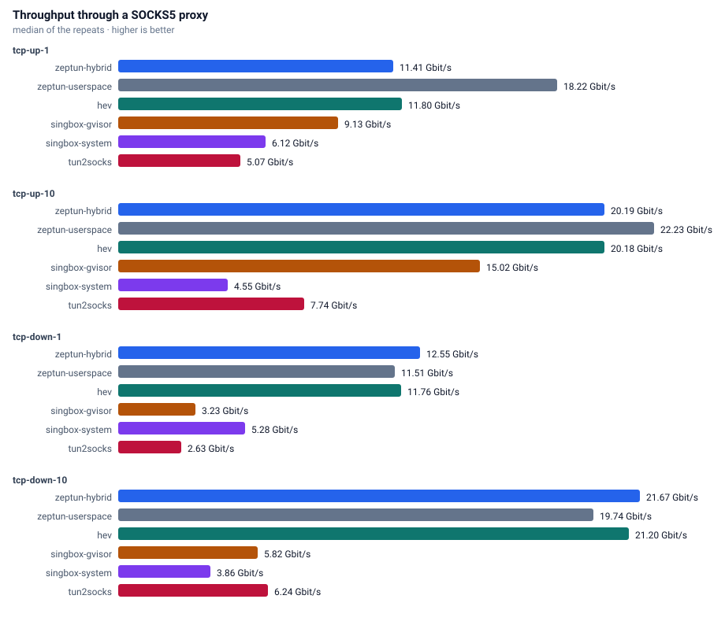
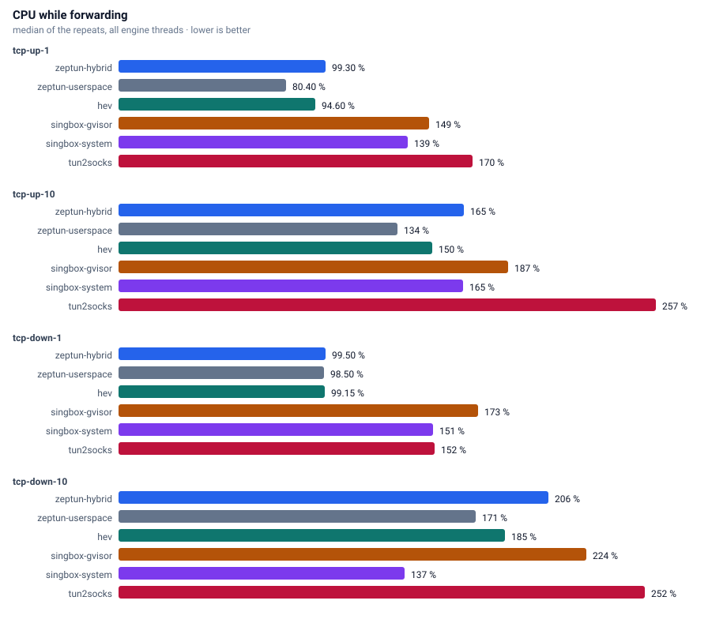
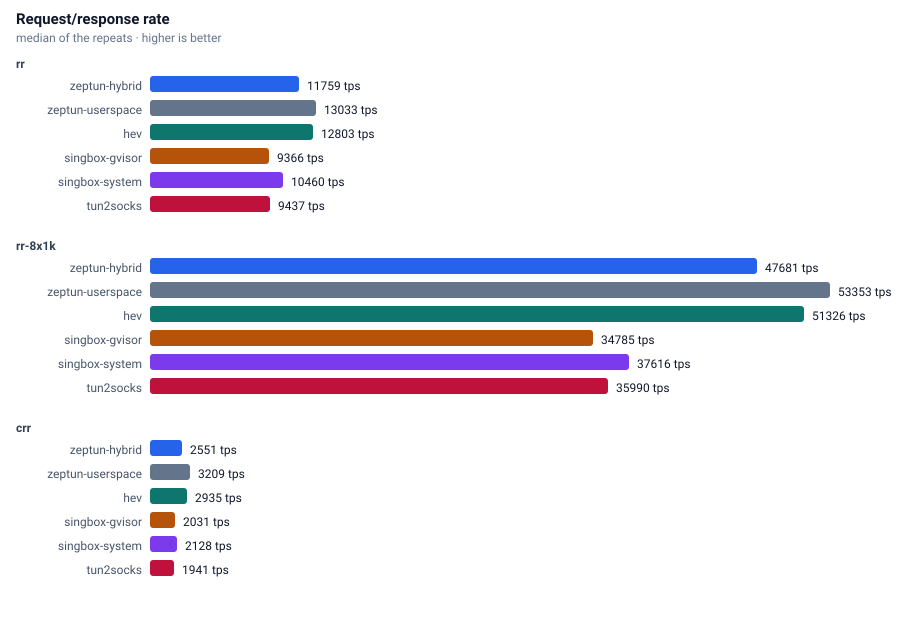
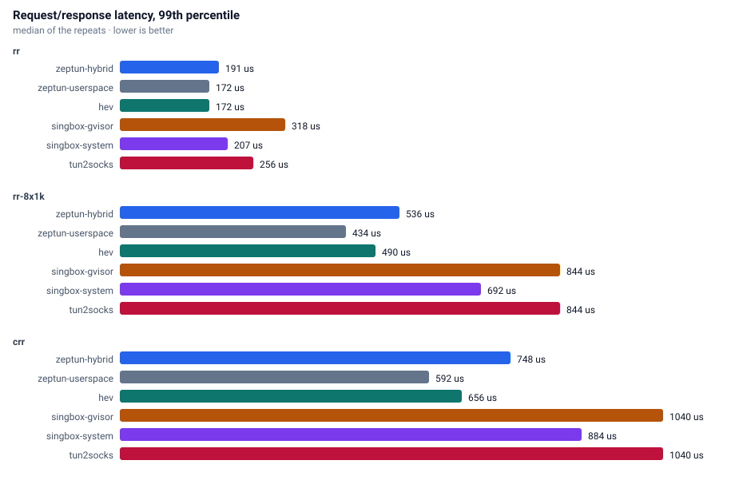
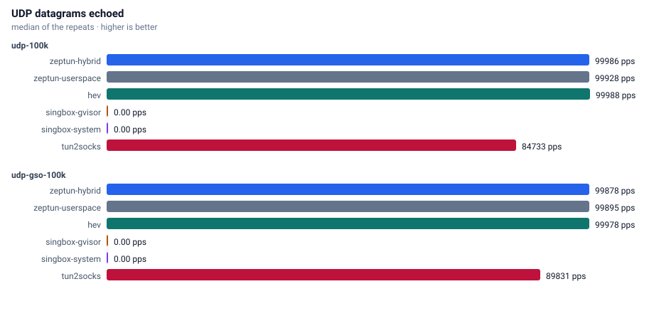
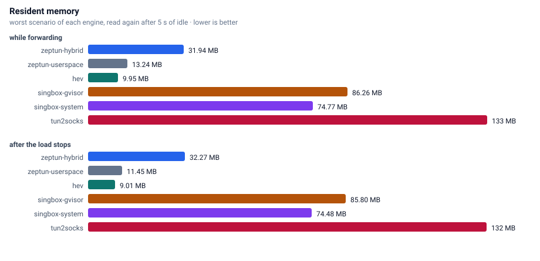

# Benchmarks

Every number on this page comes from the `benchmark` workflow in this repository, run on a GitHub-hosted runner.

## Machine

| property | value |
|---|---|
| runner image | ubuntu24 20261023.334.3 |
| cpu | AMD EPYC 9V45 96-Core Processor |
| cpu cores | 4 |
| memory | 15.6 GB |
| kernel | Linux 6.17.0-1022-azure |
| zig | 0.16.0 |
| date | 2026-10-25 |

## Method

Two network namespaces joined by a veth pair. Traffic enters the tunnel device (MTU 8500), leaves through the same SOCKS5 server (hev-socks5-server) for every engine, and reaches the servers in the second namespace. Engines are interleaved: each round starts every engine once and runs every scenario against it, so background noise spreads evenly. CPU comes from `/proc/<pid>/stat` and memory from `VmRSS`, summed over all processes of an engine.

Duration 8 s per scenario, 2 rounds, 4 queues. Memory is read twice: the highest sample while the scenario runs, and again after 5 s of idle, which shows whether an engine gives the memory back.

## Throughput

## CPU

## Request/response

## UDP

## Memory

## Raw results

| engine | scenario | median | cpu % | max rss MB | rss after idle MB |
|---|---|---:|---:|---:|---:|
| zeptun-userspace | tcp-up-1 | 29.716 Gbit/s | 80 | 6.9 | 5.4 |
| zeptun-userspace | tcp-up-10 | 34.954 Gbit/s | 134 | 16.5 | 9.9 |
| zeptun-userspace | tcp-down-1 | 19.842 Gbit/s | 98 | 14.3 | 14.1 |
| zeptun-userspace | tcp-down-10 | 30.668 Gbit/s | 171 | 17.9 | 14.5 |
| zeptun-userspace | rr | 13077 tps p50=75us p99=89us p99.9=105us  | 33 | 14.6 | 14.5 |
| zeptun-userspace | rr-8x1k | 54908 tps p50=136us p99=292us p99.9=396us  | 85 | 14.6 | 14.4 |
| zeptun-userspace | crr | 3333 tps p50=284us p99=348us p99.9=1088us  | 38 | 15.1 | 15.1 |
| zeptun-userspace | udp-100k | 99963 echo pps (100.0% of 99984 sent)  | 43 | 15.6 | 15.1 |
| zeptun-userspace | udp-gso-100k | 99969 echo pps (100.0% of 99984 sent)  | 26 | 15.9 | 15.0 |
| hev | tcp-up-1 | 20.586 Gbit/s | 95 | 8.6 | 8.4 |
| hev | tcp-up-10 | 33.147 Gbit/s | 150 | 10.4 | 8.8 |
| hev | tcp-down-1 | 20.445 Gbit/s | 99 | 8.9 | 8.8 |
| hev | tcp-down-10 | 35.787 Gbit/s | 185 | 9.5 | 8.8 |
| hev | rr | 12815 tps p50=76us p99=92us p99.9=376us  | 38 | 8.8 | 8.8 |
| hev | rr-8x1k | 53712 tps p50=136us p99=316us p99.9=412us  | 115 | 8.9 | 8.8 |
| hev | crr | 2941 tps p50=324us p99=448us p99.9=848us  | 54 | 8.8 | 8.8 |
| hev | udp-100k | 99988 echo pps (100.0% of 99992 sent)  | 51 | 9.0 | 9.0 |
| hev | udp-gso-100k | 99989 echo pps (100.0% of 99992 sent)  | 48 | 9.3 | 9.3 |
| zeptun-hybrid | tcp-up-1 | 18.623 Gbit/s | 99 | 6.0 | 5.8 |
| zeptun-hybrid | tcp-up-10 | 30.078 Gbit/s | 165 | 11.5 | 10.6 |
| zeptun-hybrid | tcp-down-1 | 18.680 Gbit/s | 100 | 10.9 | 10.4 |
| zeptun-hybrid | tcp-down-10 | 34.070 Gbit/s | 206 | 11.6 | 10.7 |
| zeptun-hybrid | rr | 12018 tps p50=81us p99=96us p99.9=428us  | 40 | 10.7 | 10.4 |
| zeptun-hybrid | rr-8x1k | 48196 tps p50=156us p99=332us p99.9=432us  | 133 | 10.5 | 12.1 |
| zeptun-hybrid | crr | 2582 tps p50=376us p99=464us p99.9=1072us  | 64 | 18.9 | 20.4 |
| zeptun-hybrid | udp-100k | 99986 echo pps (100.0% of 99992 sent)  | 58 | 24.6 | 24.3 |
| zeptun-hybrid | udp-gso-100k | 99969 echo pps (100.0% of 99984 sent)  | 26 | 26.4 | 26.0 |
| singbox-system | tcp-up-1 | 9.204 Gbit/s | 139 | 62.3 | 62.3 |
| singbox-system | tcp-up-10 | 7.395 Gbit/s | 165 | 62.5 | 62.6 |
| singbox-system | tcp-down-1 | 8.379 Gbit/s | 151 | 62.6 | 62.1 |
| singbox-system | tcp-down-10 | 6.301 Gbit/s | 137 | 62.6 | 62.4 |
| singbox-system | rr | 10563 tps p50=91us p99=160us p99.9=712us  | 57 | 62.4 | 62.0 |
| singbox-system | rr-8x1k | 37729 tps p50=198us p99=456us p99.9=976us  | 143 | 62.2 | 62.2 |
| singbox-system | crr | 2137 tps p50=456us p99=528us p99.9=952us  | 93 | 75.2 | 75.2 |
| singbox-system | udp-100k | 0 echo pps (0.0% of 99984 sent)  | 56 | 78.0 | 78.0 |
| singbox-system | udp-gso-100k | 0 echo pps (0.0% of 99988 sent)  | 48 | 78.0 | 78.0 |
| tun2socks | tcp-up-1 | 8.601 Gbit/s | 170 | 21.5 | 21.3 |
| tun2socks | tcp-up-10 | 12.403 Gbit/s | 257 | 40.5 | 39.8 |
| tun2socks | tcp-down-1 | 5.520 Gbit/s | 152 | 46.6 | 28.5 |
| tun2socks | tcp-down-10 | 10.289 Gbit/s | 252 | 142.4 | 142.5 |
| tun2socks | rr | 9561 tps p50=101us p99=134us p99.9=608us  | 60 | 151.2 | 151.2 |
| tun2socks | rr-8x1k | 35997 tps p50=208us p99=480us p99.9=920us  | 139 | 151.2 | 26.0 |
| tun2socks | crr | 1951 tps p50=496us p99=712us p99.9=1888us  | 83 | 46.6 | 43.3 |
| tun2socks | udp-100k | 86292 echo pps (86.3% of 99988 sent)  | 191 | 47.7 | 46.7 |
| tun2socks | udp-gso-100k | 91798 echo pps (91.8% of 99976 sent)  | 197 | 47.3 | 44.7 |
| singbox-gvisor | tcp-up-1 | 18.652 Gbit/s | 149 | 71.5 | 71.4 |
| singbox-gvisor | tcp-up-10 | 25.702 Gbit/s | 187 | 82.6 | 82.6 |
| singbox-gvisor | tcp-down-1 | 6.465 Gbit/s | 173 | 82.6 | 82.7 |
| singbox-gvisor | tcp-down-10 | 10.408 Gbit/s | 224 | 88.8 | 89.0 |
| singbox-gvisor | rr | 9367 tps p50=103us p99=166us p99.9=408us  | 63 | 89.0 | 72.5 |
| singbox-gvisor | rr-8x1k | 34876 tps p50=216us p99=472us p99.9=856us  | 142 | 74.6 | 74.0 |
| singbox-gvisor | crr | 2032 tps p50=476us p99=632us p99.9=1216us  | 97 | 78.4 | 78.4 |
| singbox-gvisor | udp-100k | 0 echo pps (0.0% of 99992 sent)  | 107 | 79.8 | 79.2 |
| singbox-gvisor | udp-gso-100k | 0  | 0 | 79.2 | 79.2 |

zeptun: startup 2 ms, idle 836 KB, 5 wakeups in 20 s | tcp 1000: 4060 KB (conns: 1000/1000 established, 0 failed, 2721 conn/s) | udp 1000: 4228 KB (udp flows: 1000/1000 answered, 12237 flows/s)
hev: startup 2 ms, idle 536 KB, 2 wakeups in 20 s | tcp 1000: 9293 KB (conns: 1000/1000 established, 0 failed, 3174 conn/s) | udp 1000: 9185 KB (udp flows: 1000/1000 answered, 12250 flows/s)
singbox-system: startup 51 ms, idle 57340 KB, 6 wakeups in 20 s | tcp 1000: 75907 KB (conns: 1000/1000 established, 0 failed, 2246 conn/s) | udp 1000: 72959 KB (udp flows: 0/1000 answered, 0 flows/s)
singbox-gvisor: startup 31 ms, idle 61168 KB, 124 wakeups in 20 s | tcp 1000: 96975 KB (conns: 1000/1000 established, 0 failed, 2169 conn/s) | udp 1000: 101255 KB (udp flows: 0/1000 answered, 0 flows/s)
tun2socks: startup 4 ms, idle 15832 KB, 286 wakeups in 20 s | tcp 1000: 109252 KB (conns: 1000/1000 established, 0 failed, 1869 conn/s) | udp 1000: 185772 KB (udp flows: 1000/1000 answered, 10581 flows/s)
