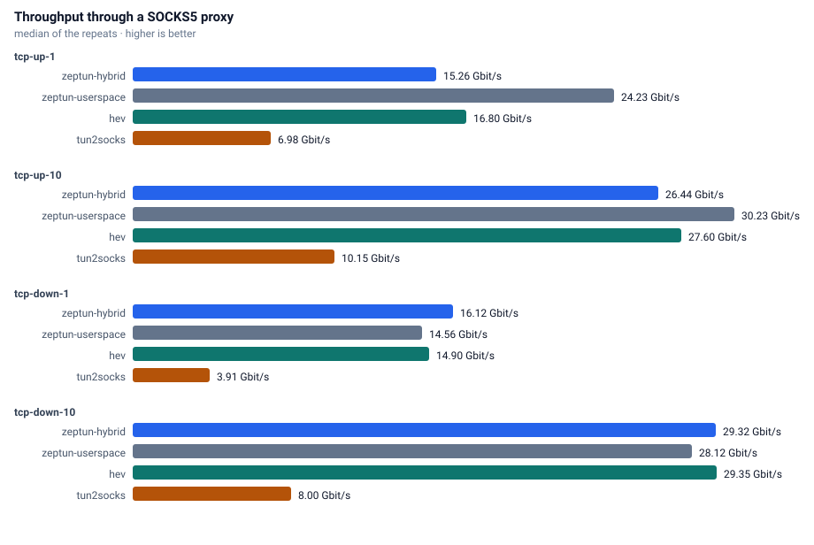
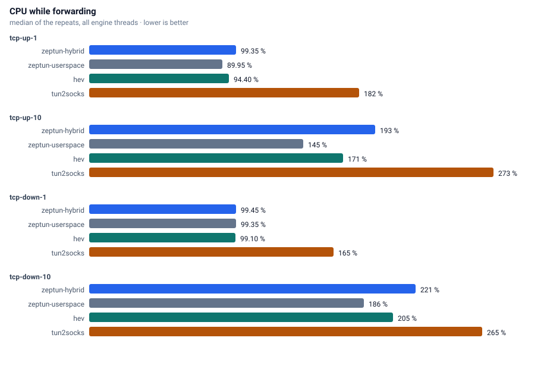
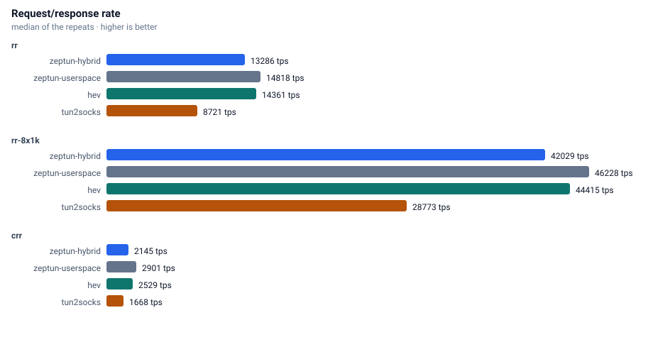
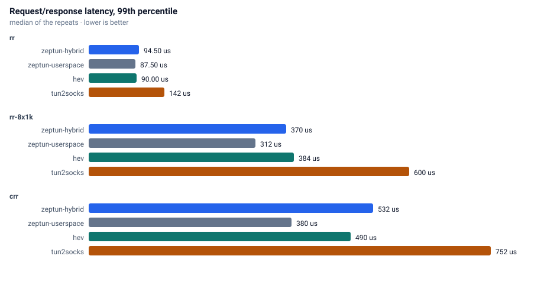
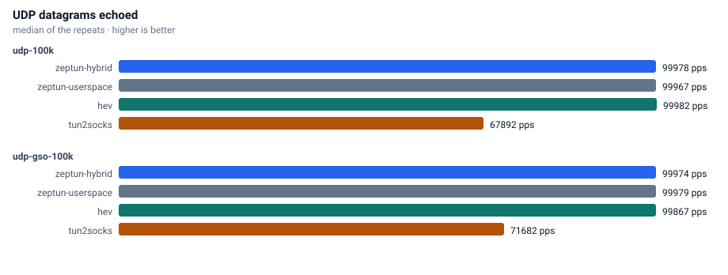
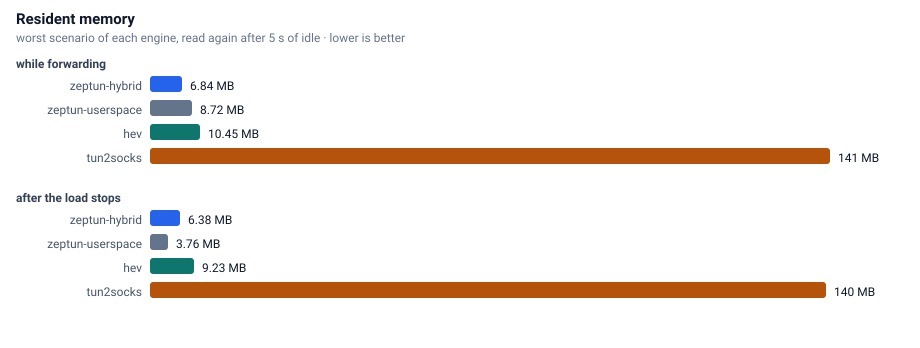

# Benchmarks

Every number on this page comes from the `benchmark` workflow in this repository, run on a GitHub-hosted runner.

## Machine

| property | value |
|---|---|
| runner image | ubuntu24 20261101.360.1 |
| cpu | AMD EPYC 9V74 80-Core Processor |
| cpu cores | 4 |
| memory | 15.6 GB |
| kernel | Linux 7.0.0-1017-azure |
| zig | 0.17.1 |
| date | 2026-11-08 |

## Method

Two network namespaces joined by a veth pair. Traffic enters the tunnel device (MTU 8500), leaves through the same SOCKS5 server (hev-socks5-server) for every engine, and reaches the servers in the second namespace. Engines are interleaved: each round starts every engine once and runs every scenario against it, so background noise spreads evenly. CPU comes from `/proc/<pid>/stat` and memory from `VmRSS`, summed over all processes of an engine.

Duration 8 s per scenario, 2 rounds, 4 queues. Memory is read twice: the highest sample while the scenario runs, and again after 5 s of idle, which shows whether an engine gives the memory back.

## Throughput

## CPU

## Request/response

## UDP

## Memory

## Raw results

| engine | scenario | median | cpu % | max rss MB | rss after idle MB |
|---|---|---:|---:|---:|---:|
| zeptun-userspace | tcp-up-1 | 24.373 Gbit/s | 90 | 3.0 | 1.7 |
| zeptun-userspace | tcp-up-10 | 30.669 Gbit/s | 145 | 9.2 | 2.7 |
| zeptun-userspace | tcp-down-1 | 14.702 Gbit/s | 99 | 2.8 | 2.7 |
| zeptun-userspace | tcp-down-10 | 29.098 Gbit/s | 186 | 6.4 | 2.8 |
| zeptun-userspace | rr | 14860 tps p50=65us p99=87us p99.9=98us  | 37 | 2.9 | 2.8 |
| zeptun-userspace | rr-8x1k | 46910 tps p50=166us p99=316us p99.9=432us  | 84 | 3.0 | 2.9 |
| zeptun-userspace | crr | 2913 tps p50=332us p99=380us p99.9=436us  | 43 | 3.8 | 3.8 |
| zeptun-userspace | udp-100k | 99967 echo pps (100.0% of 99992 sent)  | 46 | 4.5 | 3.7 |
| zeptun-userspace | udp-gso-100k | 99989 echo pps (100.0% of 99992 sent)  | 30 | 4.6 | 3.7 |
| hev | tcp-up-1 | 17.153 Gbit/s | 94 | 8.7 | 8.5 |
| hev | tcp-up-10 | 28.926 Gbit/s | 171 | 10.5 | 8.8 |
| hev | tcp-down-1 | 15.196 Gbit/s | 99 | 8.8 | 8.8 |
| hev | tcp-down-10 | 30.096 Gbit/s | 205 | 9.4 | 8.8 |
| hev | rr | 14449 tps p50=67us p99=89us p99.9=276us  | 42 | 8.8 | 8.8 |
| hev | rr-8x1k | 44464 tps p50=170us p99=372us p99.9=492us  | 115 | 8.9 | 8.8 |
| hev | crr | 2548 tps p50=380us p99=444us p99.9=560us  | 61 | 8.8 | 8.8 |
| hev | udp-100k | 99986 echo pps (100.0% of 99988 sent)  | 57 | 9.1 | 9.0 |
| hev | udp-gso-100k | 99934 echo pps (99.9% of 99992 sent)  | 56 | 9.3 | 9.3 |
| zeptun-hybrid | tcp-up-1 | 15.265 Gbit/s | 99 | 2.2 | 2.0 |
| zeptun-hybrid | tcp-up-10 | 26.824 Gbit/s | 193 | 3.8 | 2.9 |
| zeptun-hybrid | tcp-down-1 | 16.587 Gbit/s | 99 | 3.1 | 2.8 |
| zeptun-hybrid | tcp-down-10 | 30.054 Gbit/s | 221 | 3.8 | 2.9 |
| zeptun-hybrid | rr | 13413 tps p50=72us p99=94us p99.9=111us  | 44 | 2.9 | 2.7 |
| zeptun-hybrid | rr-8x1k | 42965 tps p50=178us p99=372us p99.9=492us  | 133 | 2.8 | 2.4 |
| zeptun-hybrid | crr | 2218 tps p50=440us p99=536us p99.9=856us  | 68 | 6.3 | 6.2 |
| zeptun-hybrid | udp-100k | 99988 echo pps (100.0% of 100000 sent)  | 54 | 6.9 | 6.3 |
| zeptun-hybrid | udp-gso-100k | 99979 echo pps (100.0% of 99992 sent)  | 30 | 6.8 | 6.4 |
| tun2socks | tcp-up-1 | 7.015 Gbit/s | 182 | 17.6 | 17.1 |
| tun2socks | tcp-up-10 | 10.177 Gbit/s | 273 | 35.1 | 34.9 |
| tun2socks | tcp-down-1 | 3.919 Gbit/s | 165 | 35.7 | 24.4 |
| tun2socks | tcp-down-10 | 8.135 Gbit/s | 265 | 140.4 | 140.4 |
| tun2socks | rr | 8774 tps p50=112us p99=142us p99.9=184us  | 72 | 142.5 | 142.5 |
| tun2socks | rr-8x1k | 28981 tps p50=260us p99=568us p99.9=904us  | 158 | 143.9 | 22.5 |
| tun2socks | crr | 1669 tps p50=584us p99=696us p99.9=2176us  | 95 | 37.6 | 36.3 |
| tun2socks | udp-100k | 69543 echo pps (69.6% of 99959 sent)  | 214 | 45.7 | 43.7 |
| tun2socks | udp-gso-100k | 73582 echo pps (73.6% of 99988 sent)  | 225 | 43.2 | 43.2 |

zeptun: startup 2 ms, idle 1192 KB, 5 wakeups in 20 s | tcp 1000: 3112 KB (conns: 1000/1000 established, 0 failed, 2587 conn/s) | udp 1000: 2684 KB (udp flows: 1000/1000 answered, 7598 flows/s)
hev: startup 3 ms, idle 502 KB, 2 wakeups in 20 s | tcp 1000: 9285 KB (conns: 1000/1000 established, 0 failed, 2703 conn/s) | udp 1000: 9161 KB (udp flows: 1000/1000 answered, 10032 flows/s)
singbox-system: startup 40 ms, idle 54796 KB, 6 wakeups in 20 s | tcp 1000: 70575 KB (conns: 1000/1000 established, 0 failed, 1811 conn/s) | udp 1000: 66071 KB (udp flows: 0/1000 answered, 0 flows/s)
singbox-gvisor: startup 39 ms, idle 55240 KB, 124 wakeups in 20 s | tcp 1000: 92583 KB (conns: 1000/1000 established, 0 failed, 1708 conn/s) | udp 1000: 96207 KB (udp flows: 0/1000 answered, 0 flows/s)
tun2socks: startup 4 ms, idle 11084 KB, 287 wakeups in 20 s | tcp 1000: 58740 KB (conns: 1000/1000 established, 0 failed, 1594 conn/s) | udp 1000: 115340 KB (udp flows: 1000/1000 answered, 6067 flows/s)
